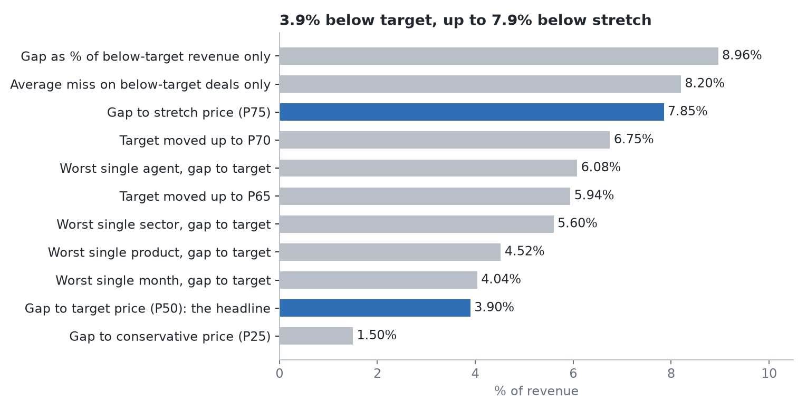
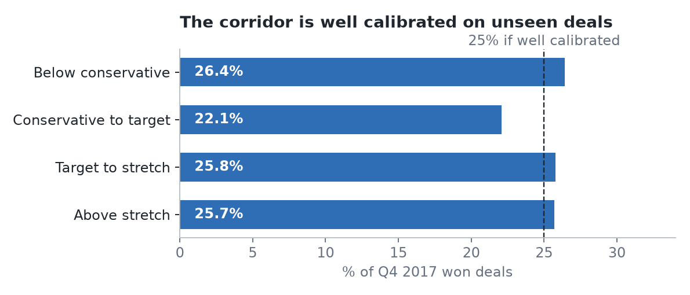
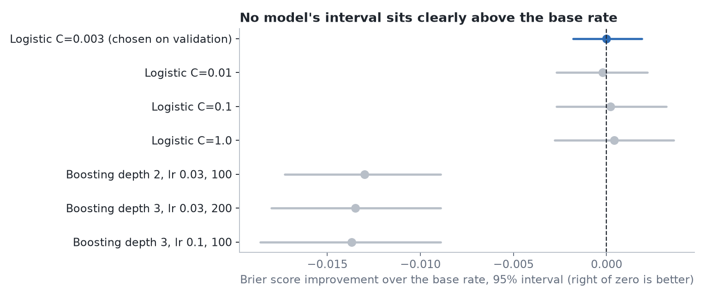

# Smart Pricing Prototype: Price Corridor on B2B CRM Data

A rule-based price corridor for B2B deals, backtested on deals it never saw, plus a test of
whether a win-probability model can do better than the base rate.

**Stack:** Python, DuckDB, pandas, scikit-learn, pytest
**Data:** [CRM Sales Opportunities](https://mavenanalytics.io/data-playground/crm-sales-opportunities)
(Maven Analytics, public domain). This is a teaching dataset for a fictitious hardware company,
MavenTech: 8,800 opportunities from October 2016 to December 2017.

## Results

| Question | Result |
|---|---|
| Opportunities in the data | 8,800 (4,238 won, 2,473 lost, 2,089 open) |
| Backtest set | 1,196 deals won in Q4 2017, each priced only from deals closed before it was engaged |
| Corridor calibration | 26.4% / 22.1% / 25.8% / 25.7% of deals in the four bands (a perfect corridor puts 25% in each) |
| Won revenue below target | **3.9%** ($109,167 of $2.80M), 95% CI 3.4% to 4.4% |
| Won revenue below stretch price | **up to 7.9%** (7.85%). The ceiling: the gain if every won deal had sold at the 75th percentile |
| Same figure across settings | 3.90% to 4.06% across min group sizes 10 to 100 and both date rules |
| Does a narrower comparison group help? | No. Sector, size, agent and account explain no more price variation than chance, and a product-only corridor scores as well |
| Win model vs base rate | Brier 0.2412 vs 0.2412, AUC 0.502 (95% CI 0.477 to 0.527) |
| Why price can't be used in the model | All 2,473 lost deals have a price of 0, so price predicts the outcome perfectly by leakage |

### Charts





## How the corridor works

1. Take won deals that closed **before** the offer was engaged.
2. Start with deals of the same product, sector and company size. If fewer than 30 deals match,
   widen to product and sector, then product and size, then product alone, and finally all
   products scaled by list price.
3. Take the 25th, 50th and 75th percentiles of price as a share of list price. Multiplied by the
   offer's list price, these are the **conservative, target and stretch** prices.

These settings were fixed before any result was seen. `outputs/sensitivity.csv` shows what
happens when they change.

## How to read the 3.9%

- The target is the median of similar deals, so close to half of all deals fall below it by
  design (48.5% here). Most of the gap is ordinary price spread around the median.
- It is an **upper bound**: it assumes every below-target deal would still have closed at the
  target price. The data can't test that, because lost deals carry no price.
- The same logic applied to the stretch price (the 75th percentile, defined before any result was
  seen) gives a ceiling of **7.9%**. Neither figure says at what price buyers would walk away.
- `outputs/claim_reconciliation.csv` lists 11 other ways to define the gap. A figure of about 7%
  would need the target set near the 72nd percentile, which is no longer a median target.

## The win models in plain words

Every model below predicts one thing: **the chance, from 0% to 100%, that a deal will be won**,
using only what is known when the deal starts (product, list price, customer sector, size and
location, sales agent, manager, region, start month, and past win rates). None of them sets a
price, a margin or the corridor. The corridor is the separate method described above.

- **AUC** asks whether a model can tell winners from losers: pick one won and one lost deal at
  random, and AUC is how often the model scores the winner higher. 0.5 is a coin flip, 1.0 is perfect.
- **Brier score** asks how accurate the percentages are: the average of (predicted chance minus
  actual outcome) squared, where a win is 1 and a loss is 0. Lower is better. The base rate, which
  predicts the average win rate of 64% for every deal, scores **0.2412**.

| Model | What it does | AUC | Ranking winners vs losers | Brier | Accuracy of its percentages |
|---|---|---|---|---|---|
| Logistic, C=0.003 (chosen on Jul–Sep data before the test) | Adds up weighted points for each detail of a deal and turns the total into a win probability. Very cautious setting: it barely trusts any single detail | 0.502 | No better than a coin flip | 0.2412 | Same as predicting the average |
| Logistic, C=0.01 | Same method, cautious setting | 0.507 | No better than a coin flip | 0.2414 | Same as predicting the average |
| Logistic, C=0.1 | Same method, moderate setting: trusts the details more | 0.520 | No better than a coin flip | 0.2410 | Same as predicting the average |
| Logistic, C=1.0 | Same method, least cautious setting | 0.526 | Slightly better than a coin flip, too little to act on | 0.2408 | Same as predicting the average |
| Gradient boosting, depth 2, learning rate 0.03, 100 trees | Builds many small decision trees in a row; each asks a few yes-or-no questions about a deal and corrects the earlier trees' mistakes | 0.527 | Slightly better than a coin flip, too little to act on | 0.2542 | Worse than predicting the average |
| Gradient boosting, depth 3, learning rate 0.03, 200 trees | Same method, deeper trees and more of them | 0.532 | Slightly better than a coin flip, too little to act on | 0.2547 | Worse than predicting the average |
| Gradient boosting, depth 3, learning rate 0.1, 100 trees | Same method, learning faster | 0.534 | Slightly better than a coin flip, too little to act on | 0.2549 | Worse than predicting the average |

**What the settings mean.** `C` controls how much a logistic model is allowed to trust the data:
smaller is more cautious. For gradient boosting, depth is how many questions each tree asks,
the learning rate is how strongly each tree corrects the last, and the tree count is how many it builds.

**Outcome.** No model predicts wins usefully. The logistic models do no better than predicting the
average win rate. Gradient boosting ranks deals very slightly better than chance, but its
percentages are less accurate than the average: it learned noise from the training data, which is
called overfitting. The details available when a deal starts carry no real signal in this dataset,
and the one that matters most, the price offered, is missing on every lost deal.

## Rerun it

The raw CSVs are already in `data/raw/`. To fetch them again, download the zip from the dataset
page linked above (a free Maven Analytics login) and unzip it into `data/raw/`.

```bash
python -m venv .venv
```

```bash
.venv/Scripts/python -m pip install -r requirements.txt
```

```bash
.venv/Scripts/python run_all.py
```

On macOS or Linux, use `.venv/bin/python` instead. A full run takes a few minutes and ends with
the unit tests.

## Project layout

| Path | What it does |
|---|---|
| `sql/01_load.sql`, `sql/02_clean.sql` | Load the raw CSVs into DuckDB, fix naming errors, add size bands |
| `src/profile_data.py` | Data profile written to `outputs/data_profile.md` |
| `src/corridor.py` | The corridor itself, plus corridors for all open deals |
| `src/backtest.py` | Walk-forward backtest, look-ahead audit, sensitivity, baselines |
| `src/reconcile_claim.py` | Alternative definitions of the gap |
| `src/win_model.py` | Win-probability models, bootstrap intervals, leakage checks |
| `src/build_report_data.py`, `src/make_charts.py` | Summary tables and the charts shown above |
| `tests/test_corridor.py` | Unit tests, including the rule that later data never changes a quote |
| `outputs/` | Every result as CSV or JSON |

## Data fixes

- `GTXPro` in the pipeline is `GTX Pro` in the products table (1,480 rows).
- `technolgy` is a typo for `technology` (12 accounts).
- Open deals often have no account, so their corridor falls back to product-level groups.

## Limits

- The company is fictitious, so the results demonstrate a method, not real revenue.
- Prices in this dataset look like random noise around list price. Real CRM data would likely
  show more structure by segment, and a narrower corridor would then earn its keep.
- The win model is tested with a fixed cutoff (trained on closes before 1 Oct 2017). That gives
  it slightly more data than it would have in practice, and it still matched the base rate.
